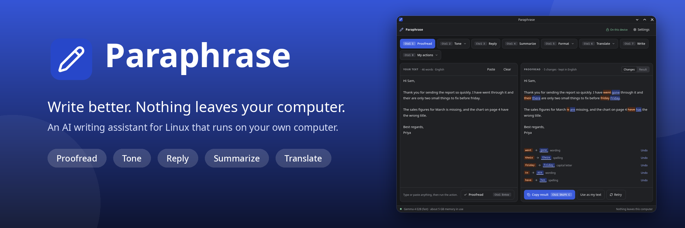
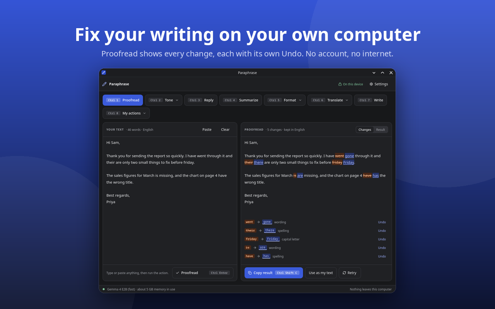
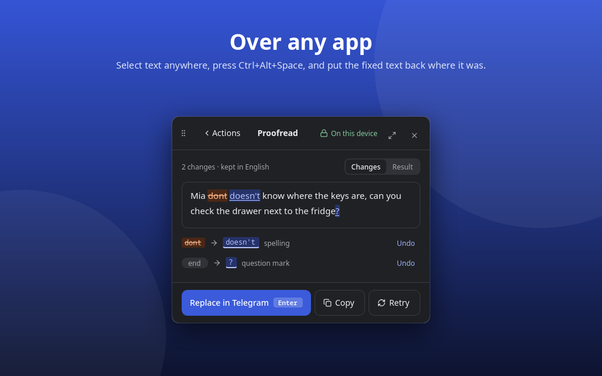
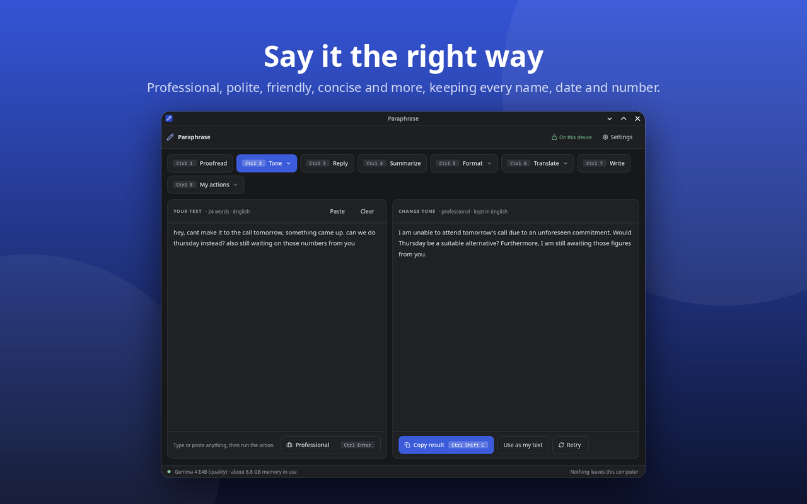
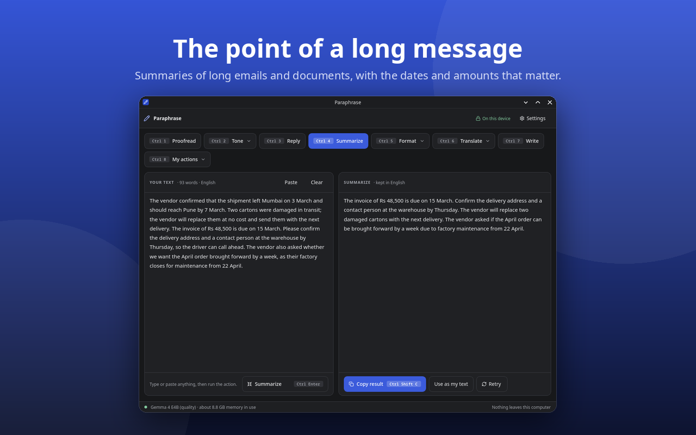
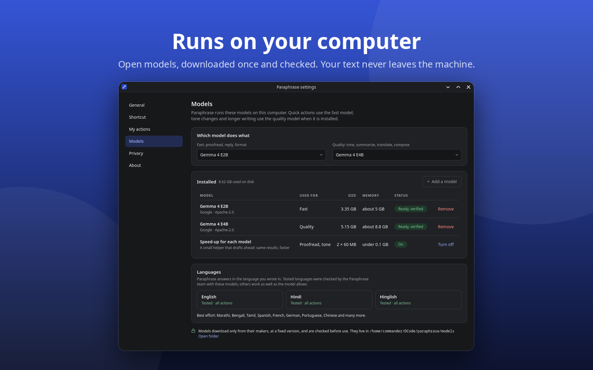

# Paraphrase - Offline AI Writing Assistant for Linux



Paraphrase fixes, rewrites, answers, summarizes and translates your writing with a language
model that runs on your own computer. Select text in any app, press a shortcut, and put the
result back where the text was, or use its window. No account, no internet once the model is
downloaded, and nothing you write leaves the machine.

<p>
  <a href="https://snapcraft.io/paraphrase"></a>
  <a href="https://aur.archlinux.org/packages/paraphrase-git"></a>
</p>

## Features

- **Proofread**: spelling, grammar and punctuation, with every change shown and an Undo for each
- **Tone**: professional, polite, friendly, concise and more, keeping names, dates and numbers
- **Reply**: three quick replies, or a full email or chat reply from a few words of yours
- **Summarize** long emails and documents, and **Format** text as bullets, a table or an email
- **Translate** into English, Hindi, Hinglish and 20 more languages
- **Write** an email, a note or a post from a short description
- **My actions**: your own instructions, saved as actions of their own
- **Over any app**: a global shortcut opens a popup on the selected text and puts the result
  back (KDE Plasma; GNOME is in progress); the window works on every desktop
- **Private**: open models (Gemma 4) run locally; history is off unless you turn it on, and
  then encrypted with a key kept in your keyring

## Screenshots









## Install

Any Linux distribution, from the Snap Store:

```sh
sudo snap install paraphrase
```

Arch Linux, from the AUR ([paraphrase-git](https://aur.archlinux.org/packages/paraphrase-git)),
built on your computer from the main branch:

```sh
yay -S paraphrase-git
```

The first run offers the models that fit your computer and checks what it downloads: Fast,
Gemma 4 E2B (3.4 GB), runs on 8 GB of memory; Quality, Gemma 4 E4B (5.2 GB), needs 16 GB and
writes better replies and drafts. You can add, remove or switch models any time in
Settings > Models. Paraphrase is in development: the edge channel and the AUR package follow
the main branch.

# Development

## Status

M0 (feasibility) and M1 (the daemon and the CLI) are done. M2 (the window and the popup)
is built, with live desktop checks left; M3 (settings, packaging, GNOME) is in progress. See `DOCS/PLAN.md` for the plan and `DOCS/PROGRESS.md` for
where things stand; code follows `DOCS/CODING_STANDARDS.md`.

## Layout

```
DOCS/          plan, decisions, progress log, coding standards, models, skills, design and mocks
daemon/        paraphrase-daemon (C++20, Qt 6): owns the model, does all inference
cli/           paraphrase, the command-line client (D-Bus, DOCS/api.md)
third_party/   llama.cpp (git submodule, pinned)
skills/        skill YAML files and GBNF grammars
eval/          Python eval harness, latency bench and datasets (offline tooling, never shipped)
scripts/       build, model download and screenshot scripts
screenshots/   the README's screenshots and banner (scripts/screenshots.sh)
models.json    model catalog: pinned upstream revisions, sha256, licences
```

## Prerequisites (Arch Linux)

```sh
sudo pacman -S --needed base-devel git cmake ninja clang vulkan-headers shaderc vulkan-icd-loader uv shellcheck snapd docker
sudo snap install kde-qt6-core24-sdk kf6-core24
sudo snap install cmake --classic
```

The daemon builds exactly as the snap pipeline does: in core24 (Ubuntu 24.04) with GCC 13,
the cmake snap and the KDE Qt snap SDK. On a host other than Ubuntu 24.04, `make build` and
`make test` run in a Docker container with that environment (`scripts/core24-run.sh`). The Vulkan driver for your GPU (`vulkan-intel`,
`vulkan-radeon` or `nvidia-utils`) is only needed for the M0 Vulkan bench.

## Quick start

```sh
git submodule update --init
make build                     # the daemon, the CLI, the app and their tests, warnings as errors (build/dev)
make test                      # eval harness tests, skill validation, daemon build and ctest
make lint                      # ruff, mypy, clang-format, clang-tidy, shellcheck, reuse
make fetch MODEL=<id>          # downloads a model from models.json and checks its sha256
make smoke MODEL=<id>          # 5 items per skill through the real model
scripts/dev-run.sh -- --help   # run the daemon against the runtime snap
make llama                     # M0 tools: llama-server and llama-bench (build/llama-cpu, -vulkan)
```

## Using the app (development build)

```sh
export PARAPHRASE_MODELS_DIR=$PWD/models          # the models make fetch downloaded
PARAPHRASE_RUN=app/paraphrase-app scripts/dev-run.sh --          # the window
PARAPHRASE_RUN=app/paraphrase-app scripts/dev-run.sh -- --popup  # the popup on the selection
```

The window works everywhere: paste or type, pick an action (Ctrl+1 to Ctrl+8), copy the result.
Without an installed model it opens the first-run setup. One copy runs at a time: starting it
again, or with `--popup`, hands over to the running one, so a desktop shortcut can run
`paraphrase-app --popup`. On KDE Wayland and X11 the app also asks for a global shortcut
(Ctrl+Alt+Space by default) and, the first time it pastes, for permission to type into other
apps; Settings, Shortcut says what works on the desktop in use (DOCS/platform-matrix.md).
`PARAPHRASE_NO_INTEGRATIONS=1` switches the desktop backends off.

## Using the CLI (development build)

```sh
export PARAPHRASE_MODELS_DIR=$PWD/models          # the models make fetch downloaded
alias paraphrase='PARAPHRASE_RUN=cli/paraphrase scripts/dev-run.sh --'
paraphrase models download fast                   # Gemma 4 E2B and its speed-up, checked
echo "Their going to the market tomorow" | paraphrase proofread
paraphrase rewrite --tone casual "Please find attached the figures."
paraphrase reply "Are you free for dinner on Friday?"   # three suggestions, one per line
paraphrase run reply "Lunch at noon?"           # run any skill by id; reply takes the message
paraphrase skills; paraphrase status; paraphrase models
```

`paraphrase batch` reads one request per line, `{"skill": "proofread", "input": {"text": "..."}}`
or with `"input"` as a plain string (the text, or the message for reply), and writes one JSON
result per line with its `line` number; a line that is not valid JSON gets
`{"error": "InvalidJson", ...}`.

The CLI starts `paraphrase-daemon` when it is not running, or runs it privately when there is
no session bus. Answers stream into a terminal; a pipe gets the finished answer only.

`scripts/screenshots.sh` remakes the images in `screenshots/` with the real models.

Licence: see `LICENSING.md`.
